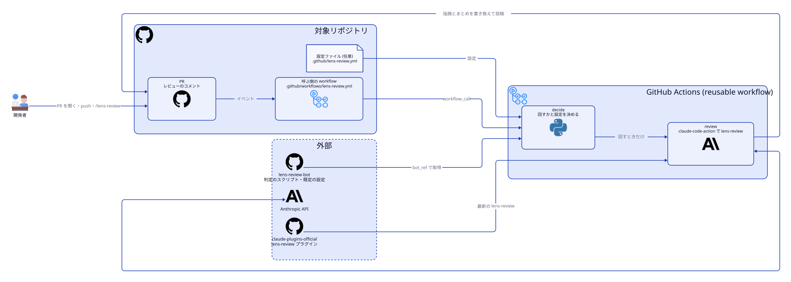

# lens-review-bot

GitHub Actions 上で [lens-review](https://github.com/reeschan/claude-plugins-official) の観点を使い、PR を自動でレビューする reusable workflow です。

- PR を開いたとき・draft を外したとき・push したとき・`/lens-review` とコメントしたときに起動し、`reeschan/claude-plugins-official` の既定ブランチにある最新の観点（`lenses/*.md`）と担当・検証の指示（`prompts/*.md`）でレビューします。
- 1 回のレビューは「スクリプトが束ねる → モデルを 1 回呼ぶ → スクリプトが投稿する」です。モデルには道具を渡さず、ファイルを読み回ったり自分で投稿したりしません。
- PR への投稿は重複を避け、まとめのコメントを 1 つに保って書き換えます。

<picture>
  <source media="(prefers-color-scheme: dark)" srcset="docs/architecture/architecture-dark.svg">
  
</picture>

図のソースは [`docs/architecture/architecture.d2`](docs/architecture/architecture.d2) です。構成が変わったら、ソースを直して arch-diagram で描き直してください。

> [!NOTE]
> 観点と担当・検証の指示は、回すたびに `reeschan/claude-plugins-official` の既定ブランチから取ります。取れなかったときはレビューせず、まとめに「失敗した段: model」と書いて失敗します。lens-review のスキル本体（`SKILL.md`）は使いません。

---

## 入れ方

### 1. Secret を登録する

対象リポジトリの Settings → Secrets and variables → Actions に、`ANTHROPIC_API_KEY` を登録します。

### 2. 呼ぶ側の workflow を置く

対象リポジトリの `.github/workflows/lens-review.yml` に、reusable workflow を呼び出す workflow を置きます（例: [`examples/caller.yml`](examples/caller.yml)）。

```yaml
name: lens-review

on:
  pull_request:
    types: [opened, reopened, ready_for_review, synchronize]
  issue_comment:
    types: [created]

permissions:
  contents: read
  pull-requests: write
  issues: write

jobs:
  lens-review:
    uses: reeschan/lens-review-bot/.github/workflows/lens-review.yml@main
    # workflow を @<tag> で固定する場合は bot_ref にも同じ値を渡す
    # with:
    #   bot_ref: v0.1.0
    secrets:
      ANTHROPIC_API_KEY: ${{ secrets.ANTHROPIC_API_KEY }}
```

- 呼ぶ側の `permissions`（`contents: read`・`pull-requests: write`・`issues: write`）は省けません。
- 安全のため workflow の参照は tag またはコミット SHA に固定し、スクリプトや既定設定の版も揃えるため、入力 `bot_ref` にも同じ値を渡してください（既定値は `main`）。

### 3. 設定ファイルを置く（任意）

設定を変える場合は、対象リポジトリの `.github/lens-review.yml` を置きます（例: [`examples/lens-review.yml`](examples/lens-review.yml)）。置かなければ既定値で動きます。

---

## 設定の項目

| 項目 | 既定 | 意味 |
|---|---|---|
| `model` | `claude-sonnet-5-5` | レビューに使うモデル |
| `max_output_tokens` | `16000` | モデルの出力の上限（1 以上 64000 以下の整数）。大きな PR で指摘が切れるときに上げる |
| `min_severity` | `major` | PR に出す重大度の下限 (`critical`・`major`・`minor`) |
| `post_rule_violations` | `true` | 規約に反する指摘を、重大度に関係なく出すか |
| `rules` | なし | 追加の規約のパスの一覧 |
| `spec` | なし | 仕様のパス |
| `exclude` | なし | 見ないパスの一覧 (glob) |

### 設定ファイルの書式

設定ファイルは標準ライブラリだけで読むため、**YAML の部分集合**のみを受け付けます。解釈できない書式、知らない項目、型の違い、値の範囲外や禁じられた文字がある場合はレビューを回さず、PR にエラーの理由をコメントして失敗します。

- 最上位の `key: value` のみ（入れ子の対応表は不可、同じキーの重複は不可、タブによる字下げは不可）。
- 空行、`#` で始まる行、引用符の外の行末 ` #` 以降は無視します。
- 値として使えるもの:
  - 真偽値: `true` / `false`
  - 整数: `max_output_tokens` は `1` 以上 `64000` 以下（真偽値は不可）
  - 文字列: 引用符なし、または `'...'` / `"..."`
  - 一覧: フロー形式 `[a, b]` またはブロック形式（次の行から同じ字下げで `- item`）
- 主な制約:
  - `model`: `[A-Za-z0-9._:@/\[\]-]+` のみ（空白不可）
  - `rules`・`spec`: リポジトリからの相対パス（空不可、`/` 始まり不可、`..` 不可、空白・引用符・`$`・`` ` ``・`\`・改行不可）
  - `exclude`: 空不可、引用符・`$`・`` ` ``・`\`・改行不可

---

## 起動と飛ばす条件

### 起動するイベント

- `pull_request`: `opened`・`reopened`・`ready_for_review`・`synchronize`
- `issue_comment`: `created`（PR へのコメントで、先頭の空白を除いた本文が `/lens-review` で始まり、その直後が文字列の終わりまたは空白であるもの）

### 飛ばす条件

次の場合はレビューを実行せずにスキップします。

- `pull_request` イベントで PR が **draft** のとき（`/lens-review` コメントでは draft でも実行します）
- **fork** からの PR
- **bot が開いた PR**（`dependabot` など、`user.type == "Bot"` の場合。secret が渡らず失敗するため）
- 閉じた（`closed`）PR へのコメント、PR 以外の issue へのコメント、`/lens-review` で始まらないコメント（`/lens-reviewer` などは対象外）
- `issue_comment` でコメントした人にリポジトリへの書き込み権限（`admin`・`maintain`・`write`）が無いとき

同じ PR に対するレビューは `concurrency` により 1 つにまとめられ、新しい実行が始まると古い実行はキャンセルされます（`cancel-in-progress: true`）。job 全体の上限は 30 分、レビューを回す step（束ねる・モデルを呼ぶ・投稿する）の上限は 25 分です。

---

## 1 回のレビューの流れ

1. **束ねる**: 規約（ルートと、変わったファイルのフォルダにある `CLAUDE.md`・`AGENTS.md`、設定の `rules`）・仕様（`spec`）・diff・変わったファイルの変更後の全文（行番号付き）・観点・既に投稿した指摘の一覧をまとめます。`exclude` に当たるファイルは diff からも全文からも除きます。束ねが文字数の上限を超えたときは、大きいファイルの全文を外す → diff を前後数行に縮める → diff もファイル名だけにする、の順に削り、削った中身をまとめに書きます。
2. **モデルを 1 回呼ぶ**: Messages API を道具なしで 1 回呼び、決まった形の指摘の一覧を受け取ります（429・529・5xx は間を空けて 3 回までやり直します）。
3. **仕分けて投稿する**: 形の確かめ → 根拠の引用が束ねにあるかの確かめ → 行が diff の中か → 下限 → 同じ指摘の除外の順に仕分け、インラインの指摘とまとめを投稿します。

使ったトークン数（入力・出力）は Actions のログと job summary に出ます。PR には出ません。

---

## PR に出るもの

- **インラインコメント**: `critical`・`major` の指摘と、`post_rule_violations: true` のときはリポジトリの規約（`CLAUDE.md`・`AGENTS.md`・`rules`）に反する指摘を重大度に関係なく出します（下限は `min_severity` で変更できます）。
  - インラインコメントの先頭には印（`<!-- lens-review: <file>:<行> <見出し> #<ハッシュ> -->`）が付きます。ハッシュは、空白を詰めた根拠の引用の SHA-256 の先頭 8 桁です。既存の印と、ファイル・見出し・ハッシュが同じ指摘は重ねて出しません（ハッシュが無い古い形の印は、ファイルと見出しが同じなら同じ指摘とみなします）。ファイルと見出しが同じでも根拠が違う指摘は、別の指摘として出ます。
  - 根拠の引用が束ねに無い指摘は捨て、`line` が diff の変更後の範囲に無い指摘はインラインでなくまとめに載せます。
  - レビュー種別は `COMMENT` のみで、承認や変更要求はしません。
- **まとめのコメント**: 1 行目が `## lens-review` の `github-actions[bot]` によるコメントを 1 つだけ作成・書き換えます。出さなかった `minor` の件数・捨てた指摘の件数・削った中身などもまとめに載ります。

---

## 失敗したとき

- `.github/lens-review.yml` が読めない・不正な場合は、理由と base SHA をまとめのコメントに書き、job は失敗します。
- 束ね（`bundle`: diff や観点の取得）・モデルの呼び出し（`model`: API キーが無い・やり直しても失敗・出力が上限で切れた・応答に指摘が無い・観点が取れない）・投稿（`post`）に失敗した場合は、スクリプトが「失敗した段: bundle / model / post」・Actions ログへのリンク・対象の head SHA をまとめに書き、job は失敗します。PR 情報の取得・チェックアウトの失敗や 25 分の時間切れは、workflow の後片付けの段が同じ形で書きます。
- モデルが答えなかった回は、何も投稿しません。
- 新しい push などにより実行がキャンセルされた場合や、投稿の直前に head が変わっていた場合は、失敗のコメントは書きません（後続の実行がまとめを更新します）。

---

## 安全について

- **fork からの PR は回りません**: `pull_request_target` を使わず、fork からの PR はスキップするため、外部コードと同じ環境に `ANTHROPIC_API_KEY` が置かれません。
- **設定は base ブランチの版を読みます**: `.github/lens-review.yml` は PR の base ブランチから API で取得するため、PR 内で設定を変えて条件を緩めても、その PR のレビューには効きません。
- **`.github/lens-review.yml` 以外は PR の head の版が動きます**: 呼ぶ側の workflow 自体（`.github/workflows/lens-review.yml`）や、チェックアウトして束ねに入れる `CLAUDE.md`・`AGENTS.md`・`rules`・`spec` と変わったファイルは PR の head の版が使われます。
- **道具を使いません**: モデルには道具を渡さず（返す形は structured outputs の JSON Schema で決めます）、ファイルの読み出しも、コマンドやコードの実行もさせません。PR のコードは実行されないため、許可する操作の設定はありません。
- **API キーはスクリプトにだけ渡ります**: `ANTHROPIC_API_KEY` は、レビューを回す step のスクリプトが Messages API を呼ぶときにだけ使います。束ねやモデルの応答には含まれず、PR のコメント・ログ・job summary にも出しません。
- **投稿の前に head を確かめます**: 投稿の直前に PR の head が変わっていたら、何も投稿せずに終わります（新しい回が、新しい head をレビューします）。
- **public リポジトリではログが公開されます**: GitHub Actions の実行ログと job summary には、使ったトークン数が出ます。PR に出さなかった指摘の内容は出しませんが、束ねに入れたファイルの内容は Anthropic API に送られます。

---

## 開発

スクリプト（標準ライブラリのみ）の単体テストを実行します。

```sh
python -m unittest discover -s tests
```
