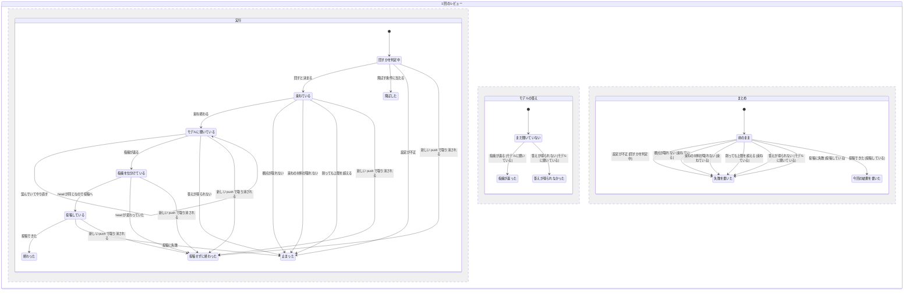

# lens-review-bot をモデル 1 回の形に作り替える

状態: Ready（状態の図に合意済み、2026-11-18）
決定の記録: [ADR 0001](../adr/0001-one-shot-model-call.md)
用語: [GLOSSARY.md](../../GLOSSARY.md)

## Problem Statement

lens-review-bot は、PR に push するたびに、claude-code-action の中で lens-review を回している。lens-review はファイルを読み回り、指摘を書き、自分で投稿するので、1 回のレビューに 13 ターンかかる。費用は 1 回あたり約 $0.10 で、その大半は材料を集める・書く・投稿するターンに使われている。

道具を使うので、その許可の設計も重い。許す一覧、`Write` の規則、サンドボックスに要る socat で、何度も詰まった。push のたびに回る bot としては、費用も仕組みも重すぎる。

## Solution

bot を「スクリプトが集める → モデルを 1 回呼ぶ → スクリプトが投稿する」形に替える。

1. スクリプトが、diff・変わったファイルの全文・規約・仕様・観点を束ねる。
2. スクリプトが Messages API を、道具なしで 1 回だけ呼び、決まった形の指摘を受け取る。
3. スクリプトが、根拠の引用を確かめ、下限で絞り、同じ指摘を除いてから、インラインの指摘とまとめを投稿する。

PR に出るものの形（印・まとめ・`COMMENT` のレビュー）は、今と変えない。手元の lens-review は、今の作りのまま残す。

## User Stories

1. As a リポジトリの持ち主, I want 1 回のレビューの費用が今より下がること, so that push のたびに回しても気にならない
2. As a リポジトリの持ち主, I want 使ったトークン数が Actions のログと job summary に出ること, so that 費用を見て設定を決められる
3. As a リポジトリの持ち主, I want 入れ方（Secret 1 つと呼ぶ側の workflow）が今と同じであること, so that 入れ直しが要らない
4. As a リポジトリの持ち主, I want 道具の許可を設定しなくてよいこと, so that 許す一覧やサンドボックスで詰まらない
5. As a リポジトリの持ち主, I want 設定の `max_turns`・`allowed_tools` を書いたら、知らない項目としてエラーになること, so that 効かない設定に気づける
6. As a リポジトリの持ち主, I want 出力の上限を `max_output_tokens` で変えられること, so that 大きな PR でも指摘が切れない
7. As a リポジトリの持ち主, I want `model`・`min_severity`・`post_rule_violations`・`rules`・`spec`・`exclude` が今と同じ意味で効くこと, so that 設定を書き直さなくてよい
8. As a PR の作者, I want lens-review の最新の観点でレビューされること, so that 観点の改善がすぐ bot に効く
9. As a PR の作者, I want インラインの指摘とまとめが今と同じ形で出ること, so that 読み方が変わらない
10. As a PR の作者, I want push で行がずれても、同じ指摘が重ねて出ないこと, so that コメントが散らからない
11. As a PR の作者, I want 同じファイルに同じ見出しで別の場所の問題があったら、それも出ること, so that 指摘が黙って落ちない
12. As a PR の作者, I want 根拠の引用が束ねに無い指摘は出ないこと, so that 作り話の指摘で手間を取られない
13. As a PR の作者, I want diff の外の行への指摘は、インラインでなくまとめに載ること, so that 投稿が失敗せず、指摘も失われない
14. As a PR の作者, I want 下限より軽い指摘の件数がまとめに載ること, so that 出なかった分があると分かる
15. As a PR の作者, I want 規約違反の指摘は、下限に関係なく出ること（`post_rule_violations` が true のとき）, so that 規約は必ず守られる
16. As a PR の作者, I want 束ねが上限を超えて削ったときは、何を削ったかがまとめに書かれること, so that 見ていない部分があると分かる
17. As a PR の作者, I want 直した指摘がまとめの一覧から消えること, so that 残っている問題だけが見える
18. As a PR の作者, I want `/lens-review` とコメントすると、今と同じ条件でやり直せること, so that 好きなときに回せる
19. As a PR の作者, I want bot が、自分の出した指摘だけを見て重ねないこと（人が書いた印では指摘が消えないこと）, so that 誰かが印をまねても指摘が隠れない。手元の lens-review の `--comment` と同じ PR で使うと、指摘が重なることはある
20. As a PR の作者, I want モデルの呼び出しが失敗したら、まとめに「失敗した段: model」と書かれること, so that レビューされていないと分かる
21. As a PR の作者, I want 形の違う指摘が 1 件混ざっても、ほかの指摘は出ること, so that 1 件の崩れでレビュー全体を失わない
22. As a bot の保守者, I want 束ね・確かめ・絞り込み・重複の判定・投稿の中身を、単体テストで確かめられること, so that モデルや GitHub を呼ばずに直せる
23. As a bot の保守者, I want 返す形・重大度・引用の決まりが、bot の中の 1 本の指示にまとまっていること, so that 観点と bot の役割の境目が分かる
24. As a bot の保守者, I want API の一時的な失敗（429・529・5xx）は、自動でやり直されること, so that たまの混雑でレビューが落ちない

## Implementation Decisions

### 組み立て

- reusable workflow の入口（起動するイベント・飛ばす条件・base の設定を読む・`concurrency`・失敗の報告）は今のまま残す。claude-code-action・プラグインのインストール・socat と bubblewrap の導入は消す。
- review の job は、チェックアウトのあとで、bot のスクリプトを 1 本走らせる。スクリプトは標準ライブラリだけで書く（Messages API は `urllib`、GitHub は `gh` を呼ぶ）。
- スクリプトは次のモジュールに分ける。
  - **設定**（今のものを直す）：`max_turns`・`allowed_tools` を消し、`max_output_tokens` を足す。既定は 16000、1 以上 64000 以下の整数。範囲外は設定のエラー。claude 向けの引数とプロンプトを組み立てる部分も消す。
  - **束ね**：PR の情報とチェックアウトから、束ねを作る。上限を超えたら削る。
  - **モデル**：束ねと指示から Messages API への要求を作って呼び、指摘の一覧と使ったトークン数を返す。
  - **指摘の仕分け**：返った指摘を、形の確かめ → 根拠の引用の確かめ → 行が diff の中か → 下限 → 同じ指摘の除外、の順に仕分ける。
  - **投稿**：インラインの指摘を 1 つのレビューとして出し、まとめを作るか書き換える。
- 投稿の前に head SHA を確かめる処理（今の stale-check）と、投稿のあとの確かめ（今の post-check）は残す。

### 束ね

- 中身は次のとおり。
  - bot の指示
  - 観点
  - lens-review の担当・検証の指示
  - 規約（ルートと、変わったファイルのフォルダにある `CLAUDE.md`・`AGENTS.md`、設定の `rules`）
  - 仕様（設定の `spec`）
  - diff
  - 変わったファイルの、変更後の全文（行番号付き）
  - 既に投稿した指摘の一覧
- `exclude` に当たるファイルは、diff からも全文からも除く。
- 観点（`lenses/*.md`）と担当・検証の指示（`prompts/*.md`）は、回すたびに `reeschan/claude-plugins-official` の既定ブランチから取る。取れなければ「失敗した段: model」として失敗にする。lens-review の SKILL.md は入れない。
- diff や既存のインラインの指摘が取れないときは、「失敗した段: bundle」として失敗にする。
- 既に投稿した指摘の一覧は、書き手が bot のインラインの指摘の印から作る（ファイルと見出し）。モデルが前後の事情を知るための参考で、重なりの判定はスクリプトだけが行う。
- 上限は文字数で決める。数字は実装のときに実際の PR で測って決める。超えたときは、次の順に、上限に収まるまで削る。
  1. 大きいファイルから、全文を外す。
  2. diff を前後数行だけに縮める。
  3. diff もファイル名だけにする。
- 削ったファイルとその段は、まとめに書く。
- 3 段を削り切っても上限を超えるとき（規約や観点だけで超えるとき）は、モデルを呼ばずに「失敗した段: model」として失敗にし、理由をまとめに書く。

### bot の指示

- bot のリポジトリに、自分用の指示を 1 本持つ。中身は、返す形、重大度の決め方、根拠の引用のしかた、束ねの外のことは書かない決まり。
- 重大度の決め方は lens-review の SKILL.md から写し、写したことを指示の冒頭に書く。
- 指示は、見つけた指摘を全部返すように言う。既出の指摘と重なるかどうかは、モデルに判断させない。
- 根拠の引用には、束ねの行番号の前置きや diff の `+`・`-` を付けないように言う。

### モデルとの約束

- structured outputs（`output_config.format` に JSON Schema）で、指摘の一覧を `{"findings": [...]}` の JSON で受け取る。道具は渡さない。Sonnet 5.5 などは `tool_choice` で道具の呼び出しを強制できない（400 になる）ため、この形にする。
- 指摘 1 件の項目：`file`、`line`（変更後の行番号）、`severity`（critical・major・minor）、`lens`、`heading`、`body`、`quote`（根拠の行）、`rule_violation`（真偽）、`rule_source`（規約に反するときの規約のパス）。
- モデルは設定の `model`（既定は Sonnet）、出力の上限は `max_output_tokens`。prompt caching は使わない。
- 429・529・5xx のときは、間を空けて 3 回までやり直す。それでも駄目なとき、`stop_reason` が `max_tokens` か `refusal` のとき、答えの本文が無いか JSON でないときは、投稿せずに失敗にする。
- 使ったトークン数（入力・出力）は、Actions のログと job summary に出す。PR には出さない。

### 指摘の仕分け

- 形が違う指摘（項目が無い、重大度が 3 段のどれでもない など）は、その 1 件だけ捨てる。
- 根拠の引用は、行番号の前置き（`12: `）と diff の行頭の `+`・`-` を外し、空白を詰めたうえで、束ねにある該当ファイルの行に含まれるかを確かめる。ハッシュも、この形にそろえた引用から作る。無ければ捨てる。捨てた件数はまとめに書く。
- `line` が diff の変更後の範囲に無い指摘は、インラインに出さず、まとめに載せる。
- 下限より軽い指摘は出さず、件数だけまとめに載せる。`post_rule_violations` が true のとき、規約違反の指摘は下限に関係なく出す。
- 同じ指摘の判定：
  - 書き手が bot の既存のインラインの指摘から、印を読む。
  - 印にハッシュがあれば、ファイル・見出し・ハッシュが同じものを同じ指摘とする。
  - ハッシュが無い古い形の印（v0.1 の bot が出したもの）は、ファイルと見出しが同じものを同じ指摘とする。
  - 書き手が bot でない印は読まない（人が印を書いて指摘を消せないように）。
  - 同じ指摘は投稿せず、まとめの一覧に「前に出したもの」として載せる。

### 投稿

- 印の形：`<!-- lens-review: <file>:<行> <見出し> #<ハッシュ> -->`。ハッシュは、空白を詰めた根拠の引用の SHA-256 の先頭 8 桁。
- 1 件の本文の順は 0.3.0 と同じ：印 → 「**[重大度] 見出し**」→ 本文 → 根拠の引用。
- インラインの指摘は、`COMMENT` の 1 つのレビューとして出す。出すものが無ければ、レビューは作らない。
- まとめは、1 行目が `## lens-review` で書き手が bot のコメントを 1 つだけ作り、あれば書き換える。中身は、head の SHA（40 桁）・今回の指摘の一覧・前に出した指摘・diff の外の指摘・出さなかった minor の件数・捨てた件数・削った中身。
- 投稿に失敗したら、その回を終えて「失敗した段: post」とする。
- 失敗のまとめにも、head の SHA を 40 桁で書く。workflow はこれを見て、スクリプトが失敗をもう書いたかを判断する。

### 1 回のレビューの状態

1 回のレビューを、3 つの並ぶ部分で表す。実行の段、モデルの答え、PR のまとめのコメント。`[ ]` は、その遷移が起きるときの実行の段。`%% never` の 5 つの規則は、pstack の statechart（TLC）で検査し、どれも破れないことを確かめた（名前を ASCII にした写しで検査）。

## Testing Decisions

- よいテストとは、モジュールの外から見た振る舞いだけを確かめるもの。入力（PR の情報・ファイル・モデルの応答）を与え、出てくる束ね・指摘の仕分けの結果・投稿の中身を確かめる。モジュールの中の関数の呼び順は確かめない。
- 外に出る呼び出し（Messages API・`gh`）は、テストでは差し替える。
- 今の設定の読み込みの単体テスト（`unittest`、標準ライブラリだけ）を手本にする。

**合意済みの seam**

1. **seam 1（単体テスト）**：次を、API と gh を差し替えて確かめる。
   - 束ね方と、上限での削り方
   - 根拠の引用の確かめ
   - JSON の読み取りと、形の違う 1 件の捨て方
   - 下限での絞り込み
   - 印での同じ指摘の判定（ハッシュあり・古い形の両方）
   - 投稿の payload とまとめの本文
   - 設定の項目の増減
2. **seam 2（手元から実際の API へ）**：手元からスクリプトを、実際の API とテスト用の PR に向けて 1 回回す。外への変更なので、やる前にユーザーに確かめる。
3. **seam 3（sandbox での通し）**：sandbox のリポジトリで Actions を通しで回し、費用（1 回の金額とトークン数）を測って、今の版の約 $0.10 と比べる。同じ head での再実行と、行がずれる push で、重ねて出ないことも確かめる。sandbox は作り直しが要り、外への変更なので、やる前にユーザーに確かめる。

## Out of Scope

- 手元の lens-review（claude-plugins-official）の作り替え。印にハッシュを付けるかどうかも、別の作業にする。
- 道具を使う 2 回目の裏取り。実際に回して、作り話の指摘が目立ったときに足す。
- prompt caching。`/lens-review` を続けて叩く使い方が多いと分かったら、観点の部分にだけ付ける。
- 直した指摘のインラインのコメントを、閉じたり消したりすること。
- 作り替えの前に、PR #1（claude-code-action の版）はそのままマージして v0.1 とする。これは別の操作として行う。

## Further Notes

- 作り替えは、PR #1 をマージしたあとの `main` から切った新しいブランチで進める。PR #1 にある CodeRabbit の指摘（ファイルと見出しが同じだと、中身の違う指摘も落ちる）は、この作り替えの「同じ指摘の判定」で直す。
- README（入れ方・設定の項目・安全について）、アーキテクチャ図、今の仕様（`lens-review-bot.md`）は、作り替えに合わせて直す。アーキテクチャ図は arch-diagram で描き直す。
- 束ねの上限の数字は、実装のときに測って決める。
