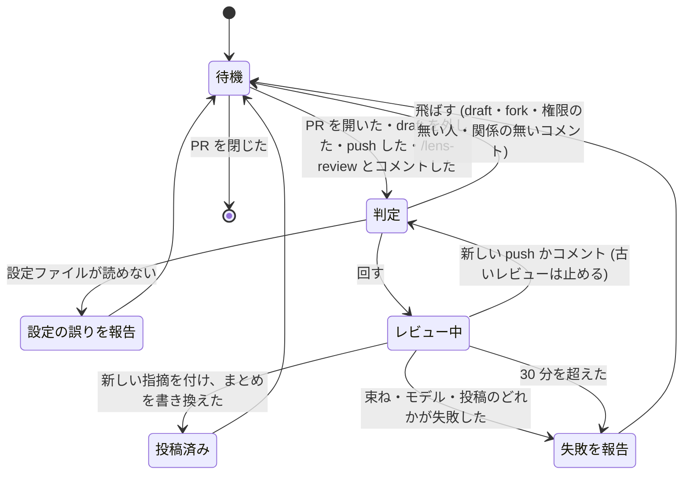

# lens-review bot: PR の自動レビュー

作り替えの経緯と決め方は [lens-review-bot-one-shot.md](lens-review-bot-one-shot.md)（[ADR 0001](../adr/0001-one-shot-model-call.md)）にある。この文書は、作り替えた後の今の仕様を書く。

## Problem Statement

lens-review は、裏を取った指摘だけを日本語で出すレビューのスキルだが、今は手元で呼んだときにしか動かない。PR を開くたびに自分で回す手間がかかり、回し忘れた PR は見られないままになる。CodeRabbit のように PR に自動でレビューを付けたいが、CodeRabbit は観点もモデルも選べず、リポジトリごとの規約を確実には反映しない。また、lens-review を直しても、自動のレビューに新しい版がすぐには届かない。

## Solution

GitHub Actions で lens-review の観点を使う bot を作る。PR を開いたとき、draft を外したとき、push のたび、`/lens-review` とコメントしたときに起動し、`reeschan/claude-plugins-official` の既定ブランチの最新の観点で PR をレビューする。1 回のレビューは「スクリプトが束ねる → モデルを 1 回呼ぶ → スクリプトが投稿する」で、モデルには道具を渡さない。PR に出すのは critical・major の指摘と、そのリポジトリの規約に反する指摘だけ。コメントの重なりを避け、まとめのコメントは 1 つを書き換える。モデル・出力の上限・出す重大度の下限・追加の規約・見ないパスは、リポジトリごとの設定ファイルで変えられる。

bot は public のリポジトリ `reeschan/lens-review-bot` に reusable workflow として置き、使うリポジトリには数行の workflow と設定ファイルだけを置く。自分のリポジトリでも、試しに入れる 仕事の組織のリポジトリでも、同じ形で使う。

## User Stories

1. As a リポジトリの持ち主, I want PR を開くと自動でレビューが付く, so that 回し忘れが無くなる
2. As a リポジトリの持ち主, I want draft のあいだは自動で回らない, so that 書きかけの PR で費用がかからない
3. As a リポジトリの持ち主, I want draft を外した時点でレビューが付く, so that 見てほしくなったときに見てもらえる
4. As a リポジトリの持ち主, I want push のたびにレビューが回り直す, so that 直した後の状態も見られる
5. As a リポジトリの持ち主, I want 回り直したときに、前と同じ指摘が重ねて付かない, so that 通知とコメントが増えすぎない
6. As a リポジトリの持ち主, I want まとめのコメントが 1 つのまま書き換わる, so that PR の会話が流れない
7. As a リポジトリの持ち主, I want 続けて push したら、古いレビューは止まって新しい方だけが回る, so that 古い差分への指摘と費用が出ない
8. As a 書き込み権限のある人, I want `/lens-review` とコメントすればもう一度回せる, so that 必要なときに見直せる
9. As a リポジトリの持ち主, I want 書き込み権限の無い人のコメントでは回らない, so that 他人に費用を使われない
10. As a リポジトリの持ち主, I want PR に出るのは critical と major だけ, so that 重要な指摘が埋もれない
11. As a リポジトリの持ち主, I want そのリポジトリの規約 (`CLAUDE.md`・`AGENTS.md`・設定に書いた規約のファイル) に反する指摘は、重大度に関係なく出る, so that 規約がレビューに確実に反映される
12. As a リポジトリの持ち主, I want 出さなかった minor の件数がまとめに載る, so that 何件あったかは分かる
13. As a リポジトリの持ち主, I want 出す重大度の下限をリポジトリごとに変えられる, so that 小さなリポジトリでは minor まで見られる
14. As a リポジトリの持ち主, I want モデルと出力の上限をリポジトリごとに変えられる, so that 重いリポジトリには重いモデルを、軽いものには安いモデルを使える
15. As a リポジトリの持ち主, I want 追加の規約や仕様のファイルを設定で渡せる, so that `CLAUDE.md` に書いていない決まりも反映される
16. As a リポジトリの持ち主, I want 見ないパスを設定できる, so that 生成物やロックファイルに費用を使わない
17. As a リポジトリの持ち主, I want 設定を書かなければ既定値で動く, so that 入れるのに手間がかからない
18. As a リポジトリの持ち主, I want lens-review を直してマージすると、次のレビューから新しい版が使われる, so that bot を別に更新しなくてよい
19. As a リポジトリの持ち主, I want 束ね・モデルの呼び出し・投稿が失敗したとき、まとめに失敗した段が書かれる, so that 黙って見られないままにならない
20. As a リポジトリの持ち主, I want PR の中で設定ファイルを書き換えても、その PR のレビューには効かない, so that 許す操作を広げる・レビューを外すといった抜け道が無い
21. As a リポジトリの持ち主, I want PR の中で規約を直したときは、直した規約でレビューされる, so that 規約の変更と実装の変更を 1 つの PR で出せる
22. As a リポジトリの持ち主, I want fork からの PR では回らない, so that secret が外のコードと同じ場所に置かれない
23. As a リポジトリの持ち主, I want レビューがリポジトリのコードを実行しない, so that PR のコードが secret のある環境で動かない
24. As a リポジトリの持ち主, I want 道具の許可を設定しなくてよい（以前の道具の設定を書いても、知らない項目としてエラーになる）, so that 許す一覧やサンドボックスで詰まらず、効かない設定にも気づける
25. As a 会社のリポジトリの担当者, I want 会社の API キーで動かせる, so that 費用とコードを渡す先の責任が会社のものとして分かれる
26. As a 会社のリポジトリの担当者, I want 組織への GitHub App のインストールなしで試せる, so that 管理者の承認を待たずに試せる
27. As a リポジトリの持ち主, I want 呼ぶ側の workflow が数行で済む, so that リポジトリを増やすのが楽になる
28. As a リポジトリの持ち主, I want CodeRabbit が入っているリポジトリでは指摘を見比べられる, so that lens-review の拾い方を評価できる
29. As a lens-review の開発者, I want 手元の `--comment` と bot が、同じ PR で指摘を重ねない, so that どちらを使っても散らからない
30. As a リポジトリの持ち主, I want レビューが 30 分を超えたら止まる, so that 暴走して費用がかかり続けない
31. As a リポジトリの持ち主, I want 使ったトークン数が Actions のログと job summary に出る, so that 費用を見て設定を決められる

## Implementation Decisions

**構成**

- 新しい public のリポジトリ `reeschan/lens-review-bot` を作る。中身は reusable workflow、スクリプト（設定・束ね・モデルの呼び出し・指摘の仕分け・投稿）、bot の指示（`prompts/bot-instruction.md`）、既定の設定、README、仕様。秘密は入れない。private の reusable workflow は別のアカウントや組織からは呼べないので、public にする。
- 使うリポジトリには、reusable workflow を呼ぶ workflow (数行) と、任意の設定ファイル `.github/lens-review.yml` を置く。secret `ANTHROPIC_API_KEY` は使うリポジトリごとに入れる (個人アカウントには組織の secret が無い)。reeschan のリポジトリは持ち主のキー、仕事の組織のリポジトリは会社が出すキー。
- 実行は、review の job が bot のスクリプト `scripts/run_review.py`（標準ライブラリだけ）を 1 本走らせる。Messages API は `urllib` で、GitHub は `gh` で呼ぶ。認証は secret `ANTHROPIC_API_KEY` を、そのスクリプトの環境変数にだけ渡す。外部の実行基盤・プラグインのインストール・サンドボックスは使わない。
- 観点（`lenses/*.md`）と担当・検証の指示（`prompts/*.md`）は、回すたびに `reeschan/claude-plugins-official` の既定ブランチから取る。版は固定しない。取れなければレビューせず「失敗した段: model」とする。lens-review の `SKILL.md` は使わない。
- コメントは workflow の `GITHUB_TOKEN` で付ける (`github-actions[bot]` の名前)。`lens-review[bot]` の名前にしたくなったら、自分の GitHub App に移す (今回はしない)。

**起動と飛ばす条件**

- 起動: `pull_request` の `opened`・`reopened`・`ready_for_review`・`synchronize` と、`issue_comment` の `created` (本文が `/lens-review` で始まる PR のコメント)。
- 飛ばす: draft の PR への `pull_request` のイベント。fork からの PR (head のリポジトリが base と違う)。コメントした人がリポジトリに書き込み権限を持たない。`/lens-review` で始まらないコメント。`pull_request_target` は使わない。
- 同じ PR のレビューは `concurrency` で 1 つにまとめ、`cancel-in-progress` で古い方を止める。job の時間の上限は 30 分。

**設定**

- 設定ファイル `.github/lens-review.yml` の項目:

  | 項目 | 既定 | 意味 |
  |---|---|---|
  | `model` | `claude-sonnet-5-5` | レビューに使うモデル |
  | `max_output_tokens` | 16000 | モデルの出力の上限 (1 以上 64000 以下の整数) |
  | `min_severity` | `major` | PR に出す重大度の下限 (`critical`・`major`・`minor`) |
  | `post_rule_violations` | `true` | 規約に反する指摘を、重大度に関係なく出すか |
  | `rules` | なし | 追加の規約のパスの一覧 |
  | `spec` | なし | 仕様のパス |
  | `exclude` | なし | 見ないパスの一覧 (glob) |

- 設定は PR の base ブランチの版から読む (base の SHA を指定して API で取る)。PR の中で設定を書き換えても、その PR には効かない。無ければ既定値。読めない (YAML として壊れている、知らない項目がある (以前の道具の設定を含む)、型が違う、値の範囲外) ときはレビューを回さず、まとめのコメントに理由を書く (既定値で黙って回さない)。
- 規約 (`CLAUDE.md`・`AGENTS.md`・`rules` に書いたファイル) と仕様は、PR の head の版を使う。スクリプトがチェックアウトした作業ツリーから読んで束ねに入れるので、head をチェックアウトする。
- 規約は、リポジトリにあるファイルだけから取る。手元の shared-memory は使わない。

**設定を読むスクリプト**

- 入力: PR のイベント (種類・draft か・head と base のリポジトリ・コメントの本文・コメントした人の権限) と、base の版の設定ファイルの中身 (無ければ無し)。
- 出力: 「回す」か「飛ばす (理由)」か「設定の誤り (理由)」のどれか。回すときは、既定値と合わせた設定を JSON で出し、review の job に渡す。
- 標準ライブラリだけの小さなスクリプトで、reusable workflow から呼ぶ。

**1 回のレビュー (`run_review.py`)**

- 流れ: 束ねる → モデルを 1 回呼ぶ → 指摘を仕分ける → 投稿する。投稿の前に head の SHA を確かめ、変わっていたら何も投稿せずに終える (新しい回が新しい head をレビューする)。
- **束ね**: bot の指示・観点・担当と検証の指示・規約 (ルートと、変わったファイルのフォルダにある `CLAUDE.md`・`AGENTS.md`、設定の `rules`)・仕様 (`spec`)・diff・変わったファイルの変更後の全文 (行番号付き)・既に投稿した指摘の一覧。`exclude` に当たるファイルは diff からも全文からも除く。文字数の上限を超えたときは、大きいファイルの全文を外す → diff を前後数行に縮める → diff もファイル名だけにする、の順に削り、削った中身をまとめに書く。
- **モデルとの約束**: structured outputs (`output_config.format` に JSON Schema) で、指摘の一覧を JSON で受け取る。道具は渡さない。設定の `model` と `max_output_tokens` を使い、prompt caching は使わない。429・529・5xx は間を空けて 3 回までやり直す。それでも駄目なとき、`stop_reason` が `max_tokens` か `refusal` のとき、答えの本文が無いか JSON でないときは、投稿せずに失敗にする。
- **指摘 1 件の項目**: `file`・`line` (変更後の行番号)・`severity`・`lens`・`heading`・`body`・`quote` (根拠の行)・`rule_violation`・`rule_source`。
- **仕分け**: 形の確かめ (違う 1 件だけ捨てる) → 根拠の引用 (空白を詰めて、束ねの該当ファイルの行に含まれるか。無ければ捨てる) → 行が diff の変更後の範囲にあるか (無ければインラインでなくまとめに載せる) → 下限 (軽いものは件数だけ。`post_rule_violations` が true のとき、規約違反は下限に関係なく出す。規約違反と認めるのは `rule_source` が束ねに入れた規約のファイルのどれかのときだけで、仕様や ADR との食い違いは下限に従う) → 同じ指摘の除外。
- **同じ指摘の判定**: bot の既存のインラインコメントの印を読む。印にハッシュと観点があれば、ファイル・観点・ハッシュが同じものを同じ指摘とする（見出しは比べない）。ハッシュと観点が無い古い形の印は、ファイルと見出しが同じものを同じ指摘とする。同じ指摘は投稿せず、まとめに「前に出した指摘」として載せる。
- **使ったトークン数**: 入力・出力のトークン数を Actions のログと job summary に出す。PR には出さない。

**投稿の決まり**

- 印の形: `<!-- lens-review: <file>:<行> <見出し> #<ハッシュ> [<観点>] -->`。ハッシュは、空白を詰めた根拠の引用の SHA-256 の先頭 8 桁。1 件の本文は、印 → 「**[重大度] 見出し**」→ 本文 → 根拠の引用の順。
- 新しい指摘は、`COMMENT` の 1 つのレビューにまとめて付ける。出すものが無ければレビューは作らない。承認・変更要求はしない。
- まとめのコメント (1 行目が「## lens-review」で書き手が bot) は 1 つだけ作り、あれば書き換える。中身は、レビューした head の完全な SHA (40 文字)・重大度ごとの件数・今回の指摘・前に出した指摘・diff の外の指摘 (本文・規約・根拠の引用を `
` で畳んで載せる)・出さなかった件数 (下限より軽いもの)・捨てた件数 (形が違う・根拠の引用が束ねに無い)・削った中身。要確認は PR に出さない。
- 手元の lens-review (`claude-plugins-official`) は今の作りのまま残る。手元の `--comment` と bot は、同じ形の印で重複を避ける (印のハッシュは bot だけが付ける)。

**失敗の扱い**

- 束ね (`bundle`: diff・既存コメントの取得)・モデルの呼び出し (`model`: API キーが無い、観点が取れない、やり直しても失敗、`max_tokens` で切れた、断られた、答えが JSON でない、束ねが上限に収まらない)・投稿 (`post`) のどれかが失敗したら、スクリプトが、まとめのコメントを「レビューできなかった。失敗した段: <段>」と理由・ログへのリンク・対象の head SHA に書き換える。job も失敗にする。
- PR 情報の取得・チェックアウトの失敗や step の時間切れ (25 分) は、workflow の後片付けの段が同じ形で書く。スクリプトが書いた回は二重に書かない。
- モデルが答えなかった回は、何も投稿しない。
- 新しい push で止められたレビュー (cancel) や、投稿の直前に head が変わっていた回は、失敗として書かない。束ね・モデルの段で失敗したときも、その時点で head が変わっていれば失敗のまとめは書かない。次のレビューがまとめを書き換える。

**状態の図 (1 つの PR のレビュー)**

## Testing Decisions

- よいテストは、外から見える振る舞いだけを確かめる。「このイベントと設定なら、回すか飛ばすか、何を渡すか」と「PR にどのコメントが付くか」を見て、中の関数の分け方には頼らない。
- 合意済みの seam:
  1. **単体テスト** (`python -m unittest discover -s tests`): 設定 (イベントと設定ファイルから「回す・飛ばす・設定の誤り」を出す。`max_output_tokens` の範囲、知らない項目) と、束ね方・上限での削り方・根拠の引用の確かめ・JSON の読み取りと形の違う 1 件の捨て方・下限での絞り込み・印での同じ指摘の判定・投稿の payload とまとめの本文を、API と `gh` を差し替えて確かめる。
  2. **手元から実際の API へ**: テスト用の PR に対して、スクリプトを実際の API で 1 回回す。外への変更なので、やる前にユーザーに確かめる。
  3. **通しの確認**: テスト用のリポジトリで、PR を開く → push する → `/lens-review` とコメントする、を順に動かす。インラインコメントが重ならないこと、まとめが 1 つのまま書き換わること、失敗を起こしたとき (例えば API キーを外す) にまとめが「失敗した段」を示すことを見る。費用 (1 回の金額とトークン数) も測る。
- 先例: lens-review の評価 (`plugins/lens-review/evals/`) は、過去の PR に対して回して CodeRabbit の指摘と突き合わせている。seam 2 はその回し方に倣う。

## Out of Scope

- 自分の GitHub App (`lens-review[bot]` の名前) への移行。
- lens-review の版の固定 (タグやコミットの指定)。
- fork からの PR のレビュー、`pull_request_target` の利用。
- PR のコードを実行する裏取り (依存の入れ込み、テストの実行) と、道具を使う 2 回目の裏取り。
- shared-memory の review-guideline を bot で使うこと。
- 承認・変更要求のレビュー (bot は `COMMENT` だけを付ける)。
- 手元の端末でのレビューの振る舞いの変更 (要確認や minor の出し方は今のまま)。
- prompt caching。
- 組織の secret や、複数のリポジトリにまとめて入れる仕組み。

## Further Notes

- 入れる順: `reeschan/atelier` で試す → 仕事の組織のリポジトリ 1 つで試す (どれにするかは、そのときに決める) → ほかの reeschan のリポジトリに広げる。
- 仕事の組織のリポジトリに入れるのは、コードを外の CI と Anthropic の API に渡す変更になる。入れる前に、会社のキーと導入の許可を担当者に確かめる。
- CodeRabbit が入っているリポジトリでは、両方の指摘を見比べて lens-review の評価に使う。入っていないリポジトリでは見比べない。
- public のリポジトリでは Actions のログも公開される。ログと job summary に出るのは、使ったトークン数と、失敗の理由・投稿した件数。指摘の内容は出さない。
- 状態の図の `%% never` のうち「同じ PR で、レビューが 2 つ同時に投稿する」と「新しいレビューが終わった後に、古いレビューが投稿する」は、古いレビューと新しいレビューを 2 つの領域にした図で TLC にかけ、どちらも成り立つことを確かめた (9 状態)。前提は、新しい push で古いレビューが止まること (`concurrency` の `cancel-in-progress`)。止まる前に投稿の途中だった分は、次のレビューが投稿済みの印 (ファイル・観点・ハッシュ) で重ならないようにする。
- 用語: 「対象のリポジトリ」はレビューされるリポジトリ。「bot のリポジトリ」は `reeschan/lens-review-bot`。「まとめのコメント」は 1 行目が「## lens-review」の PR のコメント。「投稿済みの印」はインラインコメントの先頭の `<!-- lens-review: … #<ハッシュ> -->`。
